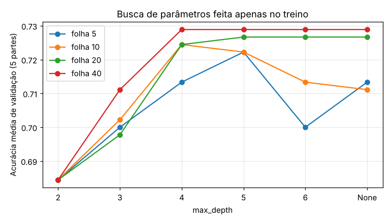
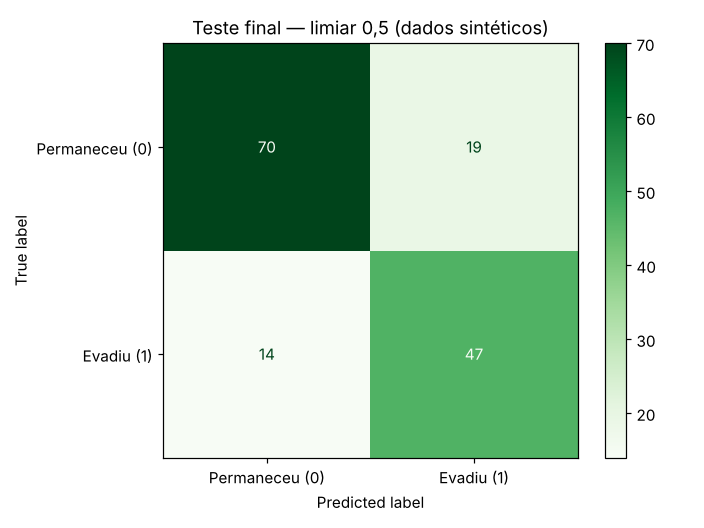
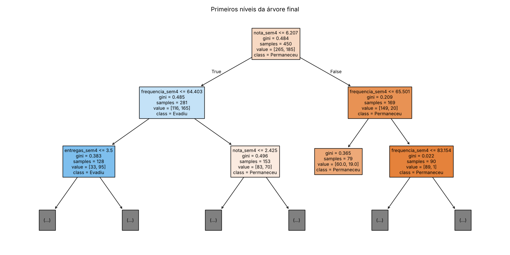
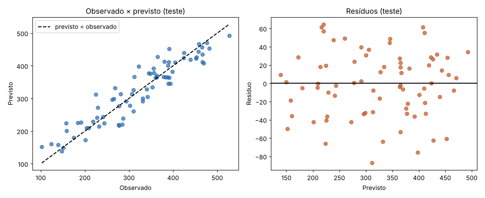

**Profa. Kadidja Valéria | UDF**  
Ciência de Dados e Aprendizado de Máquina · Sistemas de Informação · 2026.2

# Aula 2 — Registro do laboratório supervisionado

## Identificação

- Estudante ou equipe: **Henrique Ribeiro Leonardo**
- Turma: **Sistemas de Informação — 2026.2**
- Data de realização: **30/10/2026**
- Integrantes e contribuições (se em equipe): **Atividade individual.**

## Percurso escolhido

- [x] Python/Colab ou Jupyter.
- [ ] Orange Data Mining.

Use o [notebook de apoio](notebooks/laboratorio.ipynb) ou o [CSV sintético](dados/educacionais-sinteticos.csv). O CSV contém 600 registros fictícios. Atributos: `frequencia_sem4`, `nota_sem4`, `entregas_sem4`. Alvo: `evasao_fim_semestre` (0 permaneceu, 1 evadiu). As associações foram definidas pela simulação, sem validade empírica sobre estudantes reais.

## 1. Ambiente e reprodução

| Item | Registro |
| --- | --- |
| Ambiente e data | Python 3 em Linux, 30/10/2026 |
| Versões das ferramentas/bibliotecas | Python 3.13.18; NumPy 2.5.3; pandas 3.0.5; matplotlib 3.11.2; scikit-learn 1.9.1 |
| Semente aleatória | `SEMENTE = 42` na divisão, na validação cruzada, na árvore e na simulação da regressão |
| Caminho do notebook executado ou fluxo Orange | [notebooks/laboratorio-henrique.ipynb](notebooks/laboratorio-henrique.ipynb); números salvos em [notebooks/resultados_henrique.json](notebooks/resultados_henrique.json) |
| Origem dos dados e condição sintética | Carreguei o CSV fornecido pela professora ([dados/educacionais-sinteticos.csv](dados/educacionais-sinteticos.csv)) em vez de gerar de novo. Dados 100% sintéticos. |

## 2. Problema e preparação

- Pergunta de negócio: **Com o que se sabe ao fim da semana 4, a quem a equipe de apoio deveria oferecer primeiro um convite (voluntário) de acompanhamento?**
- Unidade de análise e horizonte: **Cada linha é um estudante fictício. A previsão acontece no fim da semana 4; o desfecho só é conhecido no fim do semestre.**
- Atributos disponíveis no instante da previsão: **frequência até a semana 4 (%), nota parcial (0 a 10) e número de entregas (0 a 8).**
- Variável-alvo e sua natureza: **`evasao_fim_semestre`, binária (1 = evadiu). 41% dos registros são evasão e 59% permanência, então as classes não estão muito desbalanceadas.**
- Ausências e outros problemas encontrados: **`nota_sem4` tem 30 valores faltando (5% das linhas). As outras colunas estão completas. O alvo foi sorteado a partir de uma probabilidade, então dois estudantes com os mesmos números podem ter desfechos diferentes: nenhum modelo vai acertar 100%.**
- Tratamentos e conjunto usado para aprendê-los: **Preenchi a nota faltante com a mediana usando `SimpleImputer` dentro de um `Pipeline`. Assim a mediana é calculada só com a parte de treino de cada etapa, e o teste nunca influencia esse valor. Não padronizei, porque árvore de decisão não depende de escala.**

## 3. Desenvolvimento e teste

- Método de divisão e justificativa: **Holdout estratificado 75/25 (`train_test_split`, `stratify=y`). A estratificação deixou 41,1% de evasão no treino e 40,7% no teste. A divisão aleatória só é aceitável porque os registros simulados não têm ordem no tempo.**
- Quantidades de treino e teste: **450 para treino e 150 para teste.**
- Procedimento de validação no treino: **Validação cruzada estratificada em 5 partes (`StratifiedKFold`, `shuffle=True`, semente 42), sempre dentro dos 450 de treino.**
- Parâmetros da árvore e como foram escolhidos: **Fiz a grade completa `max_depth` ∈ {2, 3, 4, 5, 6, None} × `min_samples_leaf` ∈ {5, 10, 20, 40} (24 combinações) **antes** de olhar o teste. Várias configurações ficaram empatadas em torno de 0,72–0,73. Defini a regra antes: dentro de 0,005 da melhor, fico com a mais simples. Resultado: **`max_depth=4`, `min_samples_leaf=40`** (validação 0,7289 ± 0,0303), que é o mesmo valor de validação das árvores mais profundas com folha 40, só que com menos níveis.**
- Como o teste ficou fora da seleção: **A grade, a regra de desempate e o limiar de decisão (seção 5) foram definidos só com o treino. O teste foi usado uma única vez, no final.**

### Alternativa Orange

Confira o alvo como categórico. Registre as conexões: File/Select Columns → Test & Score (Data), Tree → Test & Score (Learner), Test & Score → Confusion Matrix (Evaluation Results). Data Table permite inspeção. Se usar Preprocess, conecte o preprocessor ao learner para ajustar transformações dentro do treino. Não use apenas `Test on train data` como avaliação final.

**Fluxo e método de avaliação realmente utilizados:** Não se aplica, usei o percurso em Python.

Se comparar configurações, use validação no treino e reserve teste independente. Documente em Test & Score as entradas Data e Test Data, quando utilizadas.

## 4. Resultados calculados de classificação

| Modelo | Configuração | Acurácia de treino | Acurácia de validação e dispersão | Acurácia de teste |
| --- | --- | --- | --- | --- |
| Referência | `DummyClassifier(strategy='most_frequent')`: responde sempre "permaneceu" | 0,5889 | 0,5889 ± 0,0000 | 0,5933 |
| Árvore final | Mediana + `DecisionTreeClassifier(max_depth=4, min_samples_leaf=40, random_state=42)` | 0,7622 (modelo final); 0,7756 (média da VC) | 0,7289 ± 0,0303 | **0,7800** |

**Matriz: linhas reais e colunas previstas; classe positiva = 1.**

| Real / previsto | Permaneceu (0) | Evadiu (1) |
| --- | --- | --- |
| Permaneceu (0) | 70 (TN) | 19 (FP) |
| Evadiu (1) | 14 (FN) | 47 (TP) |

- Acurácia calculada manualmente pela matriz: **(70 + 47) / (70 + 19 + 14 + 47) = 117 / 150 = 0,78.**
- Sensibilidade da classe 1: **47 / (47 + 14) = 47 / 61 ≈ 0,770. De cada 10 estudantes que evadiram no teste, a árvore sinalizou quase 8.** Precisão: 47 / (47 + 19) = 47 / 66 ≈ 0,712; F1 ≈ 0,740.
- Comparação com referência: **A referência acerta 59,3% sem sinalizar ninguém (sensibilidade zero). A árvore sobe para 78% e encontra 47 dos 61 casos de evasão. O ganho real está na sensibilidade, não só nos 18,7 pontos de acurácia.**
- Consequências dos falsos positivos: **19 estudantes que iam continuar receberiam o convite. Custo: tempo da equipe e, se a mensagem for mal escrita, a sensação de estar sendo "marcado". Como o convite é opcional e acolhedor, é um erro aceitável.**
- Consequências dos falsos negativos: **14 estudantes que evadiram não receberiam convite direcionado. Esse é o erro mais caro, porque a ajuda pode não chegar a tempo. Por isso o modelo só define prioridade de contato; o apoio continua aberto para todos.**
- Interpretação do gráfico e da árvore: **A primeira pergunta é `nota_sem4 ≤ 6,21`. Abaixo dessa nota, a pergunta seguinte é a frequência (≤ 64,4%), e quem tem nota baixa e frequência baixa vai para um nó onde 95 de 128 evadiram; ali a árvore ainda separa por entregas (≤ 3,5). Com nota acima de 6,21, só 20 de 169 evadiram. A importância dos atributos ficou em nota 0,70, frequência 0,21 e entregas 0,09. Isso é o padrão que a simulação colocou nos dados, não uma explicação do porquê alguém evade.**

## 5. Experimentos no treino

Compare parâmetros usando apenas treino/validação. Após conhecer o teste, uma nova seleção exige novo teste independente para avaliação final.

| Experimento | Alteração | Resultado de validação | Interpretação |
| --- | --- | --- | --- |
| 1 | Grade `max_depth` × `min_samples_leaf` (5, 10, 20, 40), feita **antes** do teste | Folha 5: de 0,6844 (prof. 2) a 0,7222 (prof. 5), e treino chegando a 0,8678 sem limite de profundidade. Folha 40: 0,7289 a partir da prof. 4, com treino 0,7756. | Folhas pequenas deixam a árvore decorar: a distância treino–validação chega a 0,15 (prof. None, folha 5). Com folha 40 a distância cai para 0,047 e a validação não piora. As diferenças entre as melhores (~0,72–0,73) são menores que o desvio (~0,03), por isso usei a regra de escolher a mais simples. |
| 2 | Limiar de decisão, com previsões fora da dobra no treino | Limiar 0,3: sensibilidade 0,854, precisão 0,594, 59% sinalizados. 0,4: 0,746 / 0,624 / 49%. 0,5: 0,605 / 0,696 / 36%. | Baixar o limiar alcança mais evasões, mas mais da metade da turma passaria a receber convite. Defini antes do teste: menor limiar com precisão ≥ 0,65, o que manteve 0,5. Com uma equipe de apoio maior, faria sentido descer para 0,4. |
| 3 | Retirar um atributo (prof. 4, folha 40) | Com os três: 0,7289 ± 0,030. Sem frequência: 0,7311 ± 0,033. Sem nota: 0,6511 ± 0,030. Sem entregas: 0,7244 ± 0,039. | Sem a nota a validação cai quase 8 pontos. Tirar a frequência **não** piorou (até subiu 0,002, dentro do ruído): com essa árvore rasa, nota e entregas já carregam quase a mesma informação. |

Responda:

1. Como a profundidade e o tamanho das folhas podem afetar o sobreajuste? **Quanto mais fundo e com folhas menores, mais a árvore cria regras para pequenos grupos do treino, incluindo o ruído. No meu experimento, a árvore sem limite e com folha 5 acertou 86,8% no treino e só 71,3% na validação. Folhas de 40 registros obrigam cada regra a valer para um grupo grande, e a distância caiu para menos de 5 pontos. O outro extremo também é ruim: com profundidade 2 a árvore é simples demais e fica em 68,4% de validação (subajuste).**
2. Retirar um atributo e observar mudança no desempenho prova causalidade? **Não. Meu experimento 3 mostra isso bem: tirei a frequência e o desempenho não caiu, mas a simulação usa a frequência para gerar a evasão. O atributo importava, só que a informação dele já estava "coberta" pelos outros. O contrário também vale: um atributo pode melhorar a previsão só por estar correlacionado com a causa verdadeira (trabalho, renda, saúde). Para falar de causa seria preciso um experimento ou um método causal.**
3. Se 95% permanecem, o que acontece com um modelo que sempre prevê permanência? **Ele teria 95% de acurácia sem servir para nada: a coluna "Evadiu" da matriz ficaria zerada, TP = 0, todos os casos de evasão seriam falsos negativos e a sensibilidade seria 0. É por isso que comparo com a referência e olho a matriz, não só a acurácia.**

## 6. Regressão — seção independente

Execute a seção da biblioteca no notebook ou registre o procedimento equivalente em Orange. Dados também sintéticos. Alvo numérico: empréstimos por semana.

| Item | Registro |
| --- | --- |
| Atributos e alvo | `usuarios_ativos` (100 a 1000) e `horas_abertura` (20 a 60 h/semana). Alvo: `emprestimos_semana`. 300 semanas simuladas. |
| Divisão e preparação | Holdout 75/25 (225/75), semente 42, mediana no pipeline (não havia ausentes) e `LinearRegression`. Antes do teste, comparei atributos por validação cruzada em 5 partes no treino: os dois juntos dão MAE 28,9 e R² 0,867; só usuários, MAE 35,9 e R² 0,798; só horas, MAE 83,7 e R² 0,048. Fiquei com os dois. Coeficientes: +0,348 empréstimo por usuário ativo e +2,297 por hora de abertura; intercepto 37,3. |
| MAE do modelo e unidade | **28,59 empréstimos por semana** |
| MAE da referência | **84,73 empréstimos por semana** (`DummyRegressor`, média do treino) |
| R² do teste | **0,8774** |
| Interpretação do gráfico observado/previsto | Os pontos acompanham a diagonal do começo ao fim da faixa, sem formar curva, então uma reta descreve bem a relação. Nos cinco primeiros registros do teste os erros foram 0,5; 0,4; 36,2; 42,3 e 3,9 empréstimos, o que mostra que o erro de uma semana específica pode ser bem maior que o MAE. |
| Interpretação dos resíduos | Média −1,28 (quase zero, sem tendência a errar para um lado) e desvio 35,5, com valores de −87,2 a +64,6. Não há padrão em função do valor previsto. Mesmo assim, 12 das 75 semanas tiveram erro acima de 50 empréstimos: serve para planejar a semana, não como número exato. |
| Limitação de extrapolação | O modelo só conheceu 100–1000 usuários e 20–60 horas. Pedi uma previsão para 10.000 usuários e 100 horas e ele respondeu 3.747 empréstimos, um número que a reta calcula sem problema, mas que ninguém verificou: pode faltar livro, espaço ou atendente muito antes disso. Também não há sazonalidade nem ordem no tempo nesses dados. |

Explique por que R² não é porcentagem de acertos: **R² compara meu erro com o erro de um "chute" fixo: prever sempre a média. A fórmula é R² = 1 − (soma dos erros² do modelo) / (soma dos erros² de prever a média). Meu 0,877 significa que a soma dos erros ao quadrado ficou cerca de 88% menor que a do chute pela média. Não quer dizer que 88% das semanas foram acertadas; na regressão, praticamente nenhuma previsão bate o valor exato. E o R² pode ser negativo se o modelo for pior que a média.**

## 7. Evidências e conclusão

- Link relativo do notebook/fluxo: **[notebooks/laboratorio-henrique.ipynb](notebooks/laboratorio-henrique.ipynb)**
- Links das imagens, se houver: **[assets/henrique-grade-validacao.png](assets/henrique-grade-validacao.png), [assets/henrique-matriz-confusao.png](assets/henrique-matriz-confusao.png), [assets/henrique-arvore.png](assets/henrique-arvore.png), [assets/henrique-regressao.png](assets/henrique-regressao.png)**
- Principal aprendizado: **Toda decisão (parâmetro, desempate, limiar) precisa ser tomada antes de olhar o teste, senão o número final fica otimista. E quando várias configurações empatam dentro do desvio, a mais simples é a escolha mais segura.**
- Limitações de generalização e vieses possíveis: **Dados sintéticos com regras escolhidas por quem criou a simulação; um único teste com 150 registros (com outra semente a acurácia poderia variar alguns pontos); nenhum grupo real para checar se o modelo erra mais com estudantes trabalhadores, por exemplo; e, com turmas reais, a divisão teria que ser por semestre.**
- Cuidados com privacidade e uso responsável: **Usar o mínimo de dados, sem nome nem matrícula no modelo; acesso só para a equipe de apoio; a lista é revisada por uma pessoa antes de qualquer contato; o resultado só serve para oferecer ajuda, nunca para punir ou tomar decisão acadêmica.**

[Voltar ao início](README.md).
