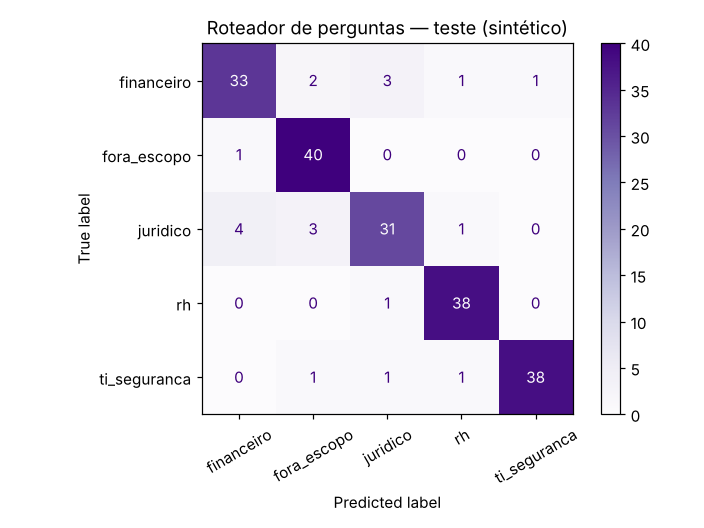

**Profa. Kadidja Valéria | UDF**  
Ciência de Dados e Aprendizado de Máquina · Sistemas de Informação · 2026.2

# Aplicação ao meu TCC — Roteador de perguntas para um assistente RAG local

## Identificação

- Estudante ou equipe: **Henrique Ribeiro Leonardo**
- Turma: **Sistemas de Informação — 2026.2**
- Data de realização: **30/10/2026**
- Integrantes e contribuições: **Experimento e texto feitos por mim. O TCC é em dupla com Pedro Luiz Oliveira da Costa.**

## 1. O sistema

Meu TCC tem como título *"Assistentes conversacionais locais e privados: desenvolvimento e avaliação de desempenho de uma arquitetura RAG com modelos de linguagem de pequeno porte aplicada à consulta de documentos sensíveis em hardware sem GPU dedicada"*, com orientação da Profa. Ma. Flávia Maria Alves Lopes.

Em resumo: um assistente que responde perguntas sobre documentos internos de uma organização. Funciona assim:

1. a pergunta é transformada em vetor (embedding);
2. o sistema busca os trechos de documentos mais parecidos (recuperação);
3. um modelo de linguagem pequeno (SLM) escreve a resposta usando esses trechos (geração).

Tudo roda **localmente**, para os documentos sensíveis não saírem da máquina, e **sem GPU**. Isso torna a velocidade o maior problema do projeto.

A parte de geração usa um modelo de linguagem pré-treinado. Esta atividade investiga onde um **modelo de ML treinado com dados do próprio sistema**, como os da disciplina, faria sentido.

## 2. Problema escolhido

Em CPU, cada pergunta que vai até o SLM custa segundos. Duas perdas fáceis de evitar:

- buscar na base **inteira** quando a pergunta claramente é de uma coleção só (por exemplo, só documentos de RH);
- mandar ao SLM perguntas que **nada têm a ver** com os documentos ("quem ganhou o jogo ontem?").

- **Pergunta de negócio:** um classificador leve consegue indicar, antes da busca, a qual coleção a pergunta pertence ou se ela está fora do escopo?
- **Decisão apoiada:** restringir a busca à coleção prevista, ou responder direto "isso está fora do que eu consulto". Se o classificador estiver inseguro, o sistema busca em tudo, como faria sem ele.
- **Unidade de análise:** uma pergunta feita ao assistente.
- **Atributo:** o texto da pergunta, conhecido no momento em que o usuário envia.
- **Alvo:** a coleção (`rh`, `juridico`, `financeiro`, `ti_seguranca` ou `fora_escopo`).
- **Tipo de tarefa:** classificação supervisionada com 5 classes. O rótulo viria de perguntas reais anotadas com a coleção que de fato as respondeu.

## 3. Dados

| Item | Registro |
| --- | --- |
| Origem | **Sintética**, gerada no próprio notebook a partir de modelos de frase ("quantos dias de {férias} eu tenho") e listas de termos por coleção. **Nenhum documento ou pergunta real foi usado.** ([CSV](dados/perguntas_rag_sinteticas.csv)) |
| Tamanho | 800 perguntas, cerca de 160 por classe |
| Ruído simulado | 20% sem acento, 7% trocadas por perguntas genéricas que servem para qualquer coleção ("qual o prazo"), 30% com "oi"/"bom dia" na frente e 5% de rótulos trocados de propósito, imitando erro de anotação |
| Por que não usar dados reais | O TCC trata justamente de documentos sensíveis. Perguntas reais podem conter nomes, valores e cláusulas. Só daria para usá-las com autorização da organização e retirando o conteúdo sensível antes. |

## 4. Método

| Item | Registro |
| --- | --- |
| Ambiente | Python 3.13.18, scikit-learn 1.9.1, pandas 3.0.5, NumPy 2.5.3. Semente 42. |
| Notebook | [notebooks/rag-roteador-henrique.ipynb](notebooks/rag-roteador-henrique.ipynb) (executado). Números em [resultados_tcc_henrique.json](notebooks/resultados_tcc_henrique.json). |
| Divisão | Holdout estratificado 75/25: 600 treino, 200 teste |
| Preparação | TF-IDF **dentro do Pipeline**, aprendido só no treino de cada dobra |
| Candidatos | Referência (classe mais frequente); Naive Bayes multinomial com TF-IDF de palavras e bigramas (`alpha` 0,1 e 1); regressão logística com TF-IDF de n-gramas de caracteres (`C` 1 e 10) |
| Seleção | Validação cruzada estratificada em 5 partes, só no treino. Regra definida antes do teste: maior F1 macro; em empate técnico (diferença menor que 0,01), o modelo mais leve, porque o TCC roda em CPU. |
| Custo | Tamanho do modelo serializado e tempo médio por pergunta |

## 5. Resultados calculados

**Validação cruzada (treino):**

| Modelo | Acurácia de treino | Acurácia de validação ± desvio | F1 macro de validação |
| --- | --- | --- | --- |
| Referência | 0,2050 | 0,2033 ± 0,0041 | 0,0676 |
| **Naive Bayes, palavras, alpha 0,1 (escolhido)** | 0,9350 | **0,9183 ± 0,0178** | 0,9189 |
| Naive Bayes, palavras, alpha 1 | 0,9333 | 0,9183 ± 0,0178 | 0,9189 |
| Regressão logística, caracteres, C = 1 | 0,9329 | 0,9183 ± 0,0178 | 0,9190 |
| Regressão logística, caracteres, C = 10 | 0,9400 | 0,9083 ± 0,0175 | 0,9087 |

Três modelos empataram (diferença de 0,0001 no F1). Pela regra, fiquei com o Naive Bayes.

**Custo em CPU (máquina de nuvem, não o hardware do TCC):**

| Modelo | Tamanho | Tempo por pergunta |
| --- | --- | --- |
| Naive Bayes, palavras | 63,9 KB | 0,46 ms |
| Regressão logística, caracteres (C = 10) | 89,8 KB | 0,47 ms |

Os dois são desprezíveis perto do tempo de geração de um SLM em CPU, que é de segundos. A diferença que importa é o tamanho e a simplicidade.

**Teste final (200 perguntas, usado uma vez):** acurácia **0,900**, F1 macro **0,899**, contra **0,205** da referência.

| Coleção | Precisão | Sensibilidade | F1 |
| --- | --- | --- | --- |
| financeiro | 0,868 | 0,825 | 0,846 |
| fora_escopo | 0,870 | 0,976 | 0,920 |
| juridico | 0,861 | 0,795 | 0,827 |
| rh | 0,927 | 0,974 | 0,950 |
| ti_seguranca | 0,974 | 0,927 | 0,950 |

**Rotear só com confiança (teste):**

| Limiar de confiança | Perguntas roteadas | Acurácia nas roteadas |
| --- | --- | --- |
| sem limiar | 100% | 0,900 |
| ≥ 0,5 | 96,5% | 0,922 |
| ≥ 0,6 | 93,5% | 0,947 |

**Exemplos:** "quantos dias de ferias eu tenho" → rh (1,00); "esqueci minha senha da vpn" → ti_seguranca (1,00); "quem ganhou o jogo ontem" → fora_escopo (1,00); "o contrato tem multa se eu sair antes" → juridico (0,96); "qual o prazo" → juridico (**0,81**, mesmo sendo uma pergunta que serve para qualquer coleção).

## 6. Interpretação

- **Resultado calculado:** 90% de acerto no teste contra 20,5% da referência, e o modelo escolhido é minúsculo (64 KB). A distância entre treino (0,935) e validação (0,918) é pequena.
- **Interpretação:** `juridico` e `financeiro` são as coleções mais confundidas entre si, o que faz sentido: "prazo", "valor" e "fornecedor" aparecem nas duas. `fora_escopo` tem sensibilidade 0,976: quase toda pergunta fora do escopo é barrada antes de chegar ao SLM.
- **Ponto de atenção:** o Naive Bayes dá confiança 0,81 para "qual o prazo", uma pergunta ambígua. Esse modelo costuma ser **confiante demais**. Com o limiar de 0,6 essa pergunta seria roteada mesmo assim, e a busca ficaria limitada ao jurídico. Antes de usar o limiar no sistema, é preciso calibrar as probabilidades (por exemplo, com `CalibratedClassifierCV`) e testar de novo.
- **Hipótese:** com perguntas reais, a acurácia deve cair, porque as pessoas escrevem de jeitos muito mais variados do que os meus modelos de frase. Só um teste com perguntas reais responde isso.
- **Uso proposto no TCC:** ligar o roteador como etapa opcional e medir, com e sem ele, o **tempo total de resposta** e a **qualidade das respostas** no hardware de testes. Se o roteador errar a coleção, a resposta pode piorar; por isso a medida de qualidade é obrigatória, não só a de tempo.

## 7. Limites, privacidade e próximos passos

- **Dados sintéticos não validam o uso real:** eu escolhi o vocabulário e as classes, então a separação entre coleções é mais limpa do que numa organização de verdade.
- **Tempo medido em outra máquina:** precisa ser medido de novo no computador sem GPU usado no TCC.
- **Privacidade:** o classificador roda localmente, junto do resto do sistema, e não envia nada para fora. Para treinar com perguntas reais, elas precisariam ser anotadas sem expor conteúdo sensível, com autorização da organização e regra de descarte.
- **Vieses:** setores que usam jargão próprio ou escrevem de forma muito abreviada podem ser roteados pior. É preciso medir o erro por setor.
- **Próximos passos:** calibrar as probabilidades; comparar com uma alternativa sem treino (usar o próprio embedding da pergunta e a coleção mais próxima); medir o efeito no tempo e na qualidade das respostas do RAG.

## Fontes

- SCIKIT-LEARN. *User Guide* (Working with text data; Naive Bayes; LogisticRegression; Probability calibration; Pipeline). https://scikit-learn.org/stable/user_guide.html. Acesso em: 30 out. 2026.
- Material do Módulo IV, Profa. Kadidja Valéria, UDF, 2026.
- Uso de IA: usei um assistente de IA (Claude, da Anthropic) para apoiar a escrita do código e do texto. Executei o notebook e conferi os números.

[Voltar ao início](README.md).
